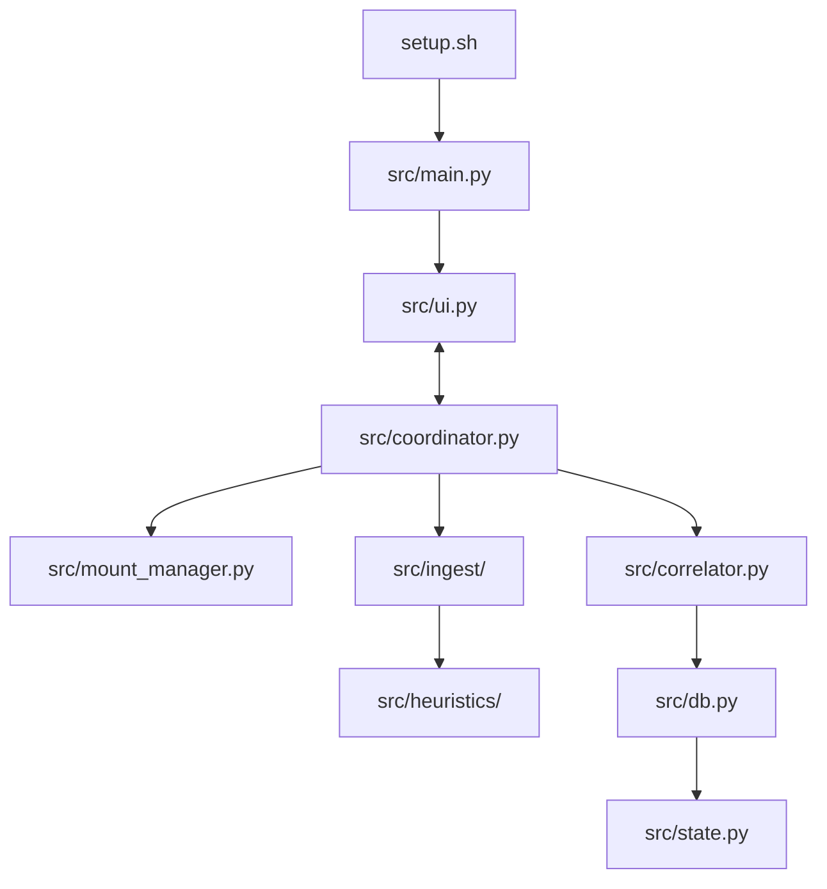

# Software Design Document (SDD): Windows 10 Disaster Recovery Application

## 1. Architecture Overview

The application follows a modular, layered architecture.

The major layers are:

1. Bootstrap and environment validation.
2. Source acquisition and mount safety.
3. Evidence ingestion.
4. Evidence correlation.
5. Heuristic classification.
6. Persistence.
7. Report export and import.
8. Background coordination.
9. Tkinter presentation.

The application is designed so that raw evidence is collected before application correlation occurs. Evidence remains first-class and exportable.



## 2. Module Specifications

### 2.1 `setup.sh`

Bootstrap orchestrator.

Responsibilities:

- Detect Linux.
- Detect Ubuntu 24.04 or compatible environment.
- Require Python 3.12.3 exactly.
- Verify `python3-venv`.
- Verify Tkinter.
- Verify required system commands.
- Verify `ntfs-3g` tooling.
- Create or reuse `Win10DRBPythonVenv`.
- Install runtime Python dependencies.
- Avoid automatic host-package installation.
- Print clear, empathetic manual instructions when prerequisites are missing.

The script shall not require or reference Conda.

The script shall not require `git`.

### 2.2 `src/main.py`

Application entry point.

Responsibilities:

- Initialize the database.
- Initialize the coordinator.
- Construct the UI.
- Register cleanup handlers.
- Start the Tkinter main loop.

### 2.3 `src/models.py`

Data transfer objects and dataclasses.

Responsibilities:

- Define immutable or controlled data structures for:
  - Block devices.
  - Sources.
  - User profiles.
  - Evidence.
  - Portable candidates.
  - Application records.
  - User-data findings.
  - Progress events.
  - Error events.

### 2.4 `src/pathnorm.py`

Path normalization utility.

Responsibilities:

- Normalize Windows-style paths.
- Compare paths case-insensitively.
- Map offline mount paths to logical Windows paths.
- Map manifest paths to source-relative paths.
- Determine whether one path is under another path.
- Support Documents-baseline comparison.

### 2.5 `src/config/evidence_locations.py`

Evidence configuration.

Responsibilities:

- Define supported registry evidence roots.
- Define evidence types.
- Define hive types.
- Define confidence defaults.
- Version the evidence-location list.

### 2.6 `src/config/heuristic_patterns.py`

Heuristic configuration.

Responsibilities:

- Define potential user-data folder patterns.
- Define portable-application patterns.
- Define exclusion patterns.
- Define severity defaults.
- Define developer-content patterns, including Visual Studio source directories.

### 2.7 `src/mount_manager.py`

Source acquisition and mount safety.

Responsibilities:

- Enumerate block devices using `lsblk --json`.
- Identify candidate NTFS partitions.
- Detect current mount state.
- Refuse externally mounted paths.
- Request confirmation before unmounting already-mounted partitions.
- Mount sources using `ntfs-3g` in read-only mode.
- Create isolated temporary mount points under `/tmp/win10_recovery`.
- Track mounted sources.
- Release mounts on exit, cancellation, and failure.

Core APIs:

```python
list_block_devices() -> list[BlockDevice]
prepare_windows_source(device_path: str, session_id: str) -> PreparedSource
prepare_secondary_mount(device_path: str, session_id: str) -> PreparedSource
release_source(source_id: str) -> None
release_all_sources() -> None
```

### 2.8 `src/ingest/manifest_generator.py`

Manifest generation module.

Responsibilities:

- Generate recursive `ntfsls` manifests from raw block devices.
- Write manifest output only to safe writable locations.
- Never write to the scanned source.
- Report progress and errors.
- Produce a manifest source descriptor.

Core API:

```python
generate_manifest(
    device_path: str,
    output_path: Path,
    progress_callback: Callable | None = None,
) -> ManifestGenerationResult
```

### 2.9 `src/ingest/hive_locator.py`

Hive discovery module.

Responsibilities:

- Locate machine hives:
  - `SOFTWARE`
  - `SYSTEM`
  - optionally `DEFAULT`
- Locate user hives:
  - `NTUSER.DAT`
  - `UsrClass.dat`
- Detect missing hives.
- Detect unreadable hives.
- Report hive warnings.

Core APIs:

```python
locate_machine_hives(source: PreparedSource) -> MachineHiveSet
locate_user_hives(source: PreparedSource) -> list[UserHiveSet]
```

### 2.10 `src/ingest/registry_parser.py`

Offline registry evidence parser.

Responsibilities:

- Parse configured registry evidence locations.
- Parse machine and user hives.
- Resolve `SYSTEM` control sets.
- Handle WOW6432Node paths.
- Extract application metadata where available.
- Emit evidence records.
- Handle corrupt or unreadable hives gracefully.

Core API:

```python
enumerate_registry_evidence(
    source: PreparedSource,
    hives: HiveSet,
    options: RegistryParseOptions,
) -> Iterator[RegistryEvidence]
```

### 2.11 `src/ingest/user_profile_parser.py`

User profile parser.

Responsibilities:

- Enumerate user profile directories.
- Identify usernames and SIDs where available.
- Locate `NTUSER.DAT` and `UsrClass.dat`.
- Resolve Documents paths.
- Resolve Desktop, Downloads, AppData, Saved Games, and source-code paths.
- Detect Visual Studio `source` and `source\repos` directories.

Core API:

```python
parse_user_profiles(source: PreparedSource) -> Iterator[UserProfile]
```

### 2.12 `src/ingest/manifest_parser.py`

Manifest ingestion module.

Responsibilities:

- Parse `ntfsls` manifests line by line.
- Avoid loading entire manifests into memory.
- Extract path evidence.
- Infer file and directory presence.
- Emit manifest evidence records.
- Support portable-application and user-data heuristics.

Core API:

```python
parse_manifest(
    manifest_path: Path,
    source: PreparedSource,
) -> Iterator[ManifestEvidence]
```

### 2.13 `src/ingest/portable_scanner.py`

Portable application discovery module.

Responsibilities:

- Identify portable application candidates from mounted sources or manifests.
- Detect executable bundles.
- Detect known portable layouts.
- Detect application-like directories on secondary drives.
- Avoid obvious false positives.
- Emit portable candidates with confidence.

Core API:

```python
discover_portable_candidates(
    source: PreparedSource,
    evidence_stream: Iterable[Evidence],
) -> Iterator[PortableCandidate]
```

### 2.14 `src/correlator.py`

Evidence correlation module.

Responsibilities:

- Group evidence into application identities.
- Match evidence by normalized names, publishers, paths, product codes, and executable names.
- Assign fingerprint status.
- Assign confidence.
- Create application-to-evidence links.

Core API:

```python
correlate_evidence(
    evidence: Iterable[Evidence],
    portable_candidates: Iterable[PortableCandidate],
) -> Iterator[CorrelatedApplication]
```

### 2.15 `src/heuristics/user_data_classifier.py`

Potential user-data classifier.

Responsibilities:

- Identify potential user-generated-content locations.
- Compare candidate paths against resolved Documents baselines.
- Detect Visual Studio source directories.
- Classify findings as inside Documents, outside Documents, or unknown.
- Assign severity and confidence.
- Produce human-readable rationale.

The classifier shall not open file contents.

Core API:

```python
classify_user_data(
    app: CorrelatedApplication | None,
    profiles: Iterable[UserProfile],
    source: PreparedSource,
) -> Iterator[UserDataFinding]
```

### 2.16 `src/heuristics/exclusions.py`

Exclusion logic.

Responsibilities:

- Define default exclusion patterns.
- Reduce false positives from caches, system directories, package managers, and development artifacts.
- Allow exclusions to remain configurable.

### 2.17 `src/db.py`

SQLite persistence layer.

Responsibilities:

- Initialize schema.
- Manage connections.
- Enforce foreign keys.
- Persist sources, profiles, evidence, applications, links, and findings.
- Support report hydration.

Core APIs:

```python
init_db(db_path: Path) -> None
save_source(source: SourceRecord) -> None
save_user_profile(profile: UserProfile) -> None
save_evidence(evidence: Evidence) -> None
link_evidence_to_app(app_id: str, evidence_id: str, relevance: str) -> None
save_application(app: CorrelatedApplication) -> None
save_user_data_finding(finding: UserDataFinding) -> None
load_session_data(session_id: str) -> SessionBundle
```

### 2.18 `src/state.py`

Report export and import manager.

Responsibilities:

- Export session data to JSON.
- Include schema version.
- Include full evidence package.
- Load report files.
- Validate report compatibility.
- Hydrate TRIAGE-mode data.

Core APIs:

```python
export_report(session_id: str, output_path: Path) -> None
import_report(report_path: Path) -> SessionBundle
```

### 2.19 `src/coordinator.py`

Background worker coordinator.

Responsibilities:

- Run scanning tasks off the UI thread.
- Coordinate source preparation, ingestion, correlation, and classification.
- Emit typed progress events.
- Emit typed error events.
- Support cancellation where practical.
- Ensure cleanup is requested on failure.

Example event types:

```python
ProgressEvent
SourcePreparedEvent
EvidenceParsedEvent
UserProfileParsedEvent
PortableCandidateEvent
ApplicationCorrelatedEvent
UserDataFindingEvent
ScanCompletedEvent
ScanFailedEvent
```

### 2.20 `src/ui.py`

Tkinter presentation layer.

Responsibilities:

- Present source list.
- Present secondary-drive advisory.
- Present scan controls.
- Present application and finding grid.
- Present details pane.
- Present single-line status bar with tooltips.
- Support report loading and export.
- Support TRIAGE mode.
- Update only from queued UI events.

## 3. Data Flow

A full active scan proceeds as follows:

1. The user adds one or more sources.
2. The UI displays the secondary-source advisory.
3. The user starts the scan.
4. The coordinator prepares sources safely.
5. The hive locator finds machine and user hives on the primary Windows source.
6. The user profile parser resolves profiles and Documents baselines.
7. The registry parser emits raw registry evidence.
8. Manifest sources are parsed line by line.
9. Mounted sources are scanned for filesystem evidence.
10. The portable scanner identifies portable candidates.
11. The correlator groups evidence into application records.
12. The user-data classifier produces potential user-data findings.
13. Results are persisted to SQLite.
14. The UI updates through queued events.
15. The user may export a report.

## 4. Safety and Error Boundaries

### 4.1 Source Safety

The mount manager is the only component allowed to prepare mounted sources.

No module may write to a scanned source.

Manifest generation must write only to safe output paths.

### 4.2 Registry Parse Failures

Registry parse failures shall produce warnings.

A corrupted hive shall not terminate the entire scan if other hives or sources remain processable.

### 4.3 Manifest Parse Failures

Malformed manifest lines shall be skipped and counted.

The parser shall continue unless the manifest is unreadable.

### 4.4 UI Error Presentation

Errors shall be user-facing and actionable.

The UI shall avoid blaming the user.

The UI shall avoid implying that data loss has already occurred.

## 5. Architectural Patterns

### Observer / Queue Pattern

Background workers emit events through a thread-safe queue.

The UI consumes events on the Tkinter thread.

### DTO Boundaries

Ingestion, correlation, and heuristic layers exchange dataclasses.

Database rows are not passed directly to UI widgets.

### Evidence-First Model

Raw evidence is stored before correlation.

This preserves orphaned and portable evidence.

### Testability

Modules shall be testable with fixture manifests, synthetic hive data, mocked subprocess calls, and temporary SQLite databases.

Unit tests shall not require root, live drives, or real Windows installations.