# Source Directory README

## 1. Python Project Directory Structure

```text
win10-disaster-recovery/
├── setup.sh                        # Bootstrap script
├── requirements.txt                # Runtime Python dependencies
├── requirements-dev.txt            # Development/testing dependencies
├── README.md                       # Root project README
├── src/
│   ├── __init__.py
│   ├── gen_api.py                  # Used by `EmeraldWalk.RunOnSave`
│   ├── main.py                     # Application entry point
│   ├── models.py                   # DTOs / dataclasses
│   ├── pathnorm.py                 # Windows/offline path normalization
│   ├── mount_manager.py            # Block device discovery and safe mounting
│   ├── db.py                       # SQLite persistence
│   ├── state.py                    # Report export/import
│   ├── coordinator.py              # Background worker coordinator
│   ├── ui.py                       # Tkinter presentation layer
│   ├── correlator.py               # Evidence-to-application correlation
│   ├── config/
│   │   ├── __init__.py
│   │   ├── evidence_locations.py   # Supported evidence roots and bounds
│   │   └── heuristic_patterns.py   # Heuristic and exclusion patterns
│   ├── ingest/
│   │   ├── __init__.py
│   │   ├── manifest_generator.py   # ntfsls manifest generation
│   │   ├── manifest_parser.py      # ntfsls manifest reader
│   │   ├── hive_locator.py         # Hive file discovery
│   │   ├── registry_parser.py      # Offline registry evidence parser
│   │   ├── user_profile_parser.py  # User profile and shell-folder resolution
│   │   └── portable_scanner.py     # Portable application discovery
│   └── heuristics/
│       ├── __init__.py
│       ├── user_data_classifier.py # Potential user-data classification
│       └── exclusions.py           # False-positive exclusions
└── tests/
    ├── __init__.py
    ├── test_models.py
    ├── test_mount_manager.py
    ├── test_pathnorm.py
    ├── test_heuristic_patterns.py
    ├── test_manifest_parser.py
    ├── test_registry_parser.py
    ├── test_user_profile_parser.py
    ├── test_portable_scanner.py
    ├── test_correlator.py
    ├── test_user_data_classifier.py
    ├── test_db.py
    └── test_state.py
```

### 1.1 Dependency Graph

```mermaid
flowchart TD
    subgraph L0["Entry Point"]
        MAIN["src/main.py"]
    end
    subgraph L1["Presentation"]
        UI["src/ui.py"]
    end
    subgraph L2["Orchestration"]
        COORD["src/coordinator.py"]
    end
    subgraph L3["Session Services"]
        STATE["src/state.py"]
    end
    subgraph L4["Acquisition & Persistence"]
        MOUNT["src/mount_manager.py"]
        DB["src/db.py"]
    end
    subgraph L5["Evidence Ingestion"]
        HIVE["src/ingest/hive_locator.py"]
        PROFILE["src/ingest/user_profile_parser.py"]
        REG["src/ingest/registry_parser.py"]
        MGEN["src/ingest/manifest_generator.py"]
        MPARSE["src/ingest/manifest_parser.py"]
        PORT["src/ingest/portable_scanner.py"]
    end
    subgraph L6["Correlation & Heuristics"]
        CORR["src/correlator.py"]
        CLASS["src/heuristics/user_data_classifier.py"]
        EXCL["src/heuristics/exclusions.py"]
    end
    subgraph L7["Foundations (Tier 0 antichain)"]
        MODELS["src/models.py"]
        PATHNORM["src/pathnorm.py"]
        CFG_EV["src/config/evidence_locations.py"]
        CFG_HEUR["src/config/heuristic_patterns.py"]
    end

    %% ---- wires into models.py (sky blue) ----
    UI --> MODELS
    COORD --> MODELS
    STATE --> MODELS
    MOUNT --> MODELS
    DB --> MODELS
    HIVE --> MODELS
    PROFILE --> MODELS
    REG --> MODELS
    MGEN --> MODELS
    MPARSE --> MODELS
    PORT --> MODELS
    CORR --> MODELS
    CLASS --> MODELS

    %% ---- wires into pathnorm.py (bluish green) ----
    PROFILE --> PATHNORM
    REG --> PATHNORM
    MGEN --> PATHNORM
    MPARSE --> PATHNORM
    PORT --> PATHNORM
    CORR --> PATHNORM
    CLASS --> PATHNORM
    COORD --> PATHNORM

    %% ---- wires into evidence_locations.py (orange) ----
    HIVE --> CFG_EV
    PROFILE --> CFG_EV
    REG --> CFG_EV

    %% ---- wires into heuristic_patterns.py (reddish purple) ----
    MGEN --> CFG_HEUR
    MPARSE --> CFG_HEUR
    PORT --> CFG_HEUR
    CLASS --> CFG_HEUR
    EXCL --> CFG_HEUR

    %% ---- wires into exclusions.py (vermillion) ----
    PORT --> EXCL
    CLASS --> EXCL

    %% ---- wires into db.py (blue) ----
    MAIN --> DB
    COORD --> DB
    STATE --> DB

    %% ---- wires into mount_manager.py (yellow) ----
    MAIN --> MOUNT
    COORD --> MOUNT

    %% ---- orchestration / control wiring (neutral gray) ----
    COORD --> STATE
    COORD --> HIVE
    COORD --> PROFILE
    COORD --> REG
    COORD --> MGEN
    COORD --> MPARSE
    COORD --> PORT
    COORD --> CORR
    COORD --> CLASS
    MAIN --> UI
    MAIN --> COORD
    UI --> COORD

    %% ---- pending wires (dashed) ----
    UI -.-> CFG_EV
    UI -.-> CFG_HEUR

    %% ---- node fills mirror incoming wire color ----
    classDef cSky fill:#56B4E9,stroke:#56B4E9,color:#0B0B0F;
    classDef cGreen fill:#009E73,stroke:#009E73,color:#0B0B0F;
    classDef cOrange fill:#E69F00,stroke:#E69F00,color:#0B0B0F;
    classDef cPurple fill:#CC79A7,stroke:#CC79A7,color:#0B0B0F;
    classDef cVerm fill:#D55E00,stroke:#D55E00,color:#FFFFFF;
    classDef cBlue fill:#0072B2,stroke:#0072B2,color:#FFFFFF;
    classDef cYellow fill:#F0E442,stroke:#F0E442,color:#0B0B0F;
    classDef cCtrl fill:#252538,stroke:#9E9E9E,color:#E8E8E8;
    class MODELS cSky;
    class PATHNORM cGreen;
    class CFG_EV cOrange;
    class CFG_HEUR cPurple;
    class EXCL cVerm;
    class DB cBlue;
    class MOUNT cYellow;
    class MAIN,UI,COORD,STATE,HIVE,PROFILE,REG,MGEN,MPARSE,PORT,CORR,CLASS cCtrl;

    %% ---- wire colors (index-ordered per declaration above) ----
    linkStyle 0,1,2,3,4,5,6,7,8,9,10,11,12 stroke:#56B4E9,stroke-width:3px;
    linkStyle 13,14,15,16,17,18,19,20 stroke:#009E73,stroke-width:3px;
    linkStyle 21,22,23 stroke:#E69F00,stroke-width:3px;
    linkStyle 24,25,26,27,28 stroke:#CC79A7,stroke-width:3px;
    linkStyle 29,30 stroke:#D55E00,stroke-width:3px;
    linkStyle 31,32,33 stroke:#0072B2,stroke-width:3px;
    linkStyle 34,35 stroke:#F0E442,stroke-width:3px;
    linkStyle 36,37,38,39,40,41,42,43,44,45,46,47 stroke:#9E9E9E,stroke-width:2px;
    linkStyle 48 stroke:#E69F00,stroke-width:3px,stroke-dasharray:5 5;
    linkStyle 49 stroke:#CC79A7,stroke-width:3px,stroke-dasharray:5 5;
```



#### Wire color legend

| Color | Hex | Wire lands on (dependency target) |
|---|---|---|
| Sky blue | `#56B4E9` | `src/models.py` |
| Bluish green | `#009E73` | `src/pathnorm.py` |
| Orange | `#E69F00` | `src/config/evidence_locations.py` |
| Reddish purple | `#CC79A7` | `src/config/heuristic_patterns.py` |
| Vermillion | `#D55E00` | `src/heuristics/exclusions.py` |
| Blue | `#0072B2` | `src/db.py` |
| Yellow | `#F0E442` | `src/mount_manager.py` |
| Neutral gray | `#9E9E9E` | Orchestration/control wiring (coordinator stage invocation, entry/control flow, session-service binding). Contract includes for gray wires are given by the dependency table, not by color. |

Dashed wire = pending resolution at the consuming module's DRAFT freeze. Palette: Okabe–Ito (color-blind-safe); gray is a neutral. Colors aid tracing only — the dependency table is normative.

### 1.2 Forward/Reverse dependency table

| Target module | Direct dependencies (attach these sheets) | Direct dependents |
|---|---|---|
| `src/main.py` | coordinator, db, mount_manager, ui | — |
| `src/ui.py` | coordinator, models | main |
| `src/coordinator.py` | correlator, db, heuristics/user_data_classifier, all six `ingest/*`, models, mount_manager, pathnorm, state | main, ui |
| `src/state.py` | db, models | coordinator |
| `src/mount_manager.py` | models | coordinator, main |
| `src/db.py` | models | coordinator, main, state |
| `src/ingest/hive_locator.py` | config/evidence_locations, models | coordinator |
| `src/ingest/user_profile_parser.py` | config/evidence_locations, models, pathnorm | coordinator |
| `src/ingest/registry_parser.py` | config/evidence_locations, models, pathnorm | coordinator |
| `src/ingest/manifest_generator.py` | config/heuristic_patterns, models, pathnorm | coordinator |
| `src/ingest/manifest_parser.py` | config/heuristic_patterns, models, pathnorm | coordinator |
| `src/ingest/portable_scanner.py` | config/heuristic_patterns, exclusions, models, pathnorm | coordinator |
| `src/correlator.py` | models, pathnorm | coordinator |
| `src/heuristics/user_data_classifier.py` | config/heuristic_patterns, exclusions, models, pathnorm | coordinator |
| `src/heuristics/exclusions.py` | config/heuristic_patterns | portable_scanner, user_data_classifier |
| `src/models.py` | — *(leaf; no Tier 0 peer imports)* | 13 modules: coordinator, correlator, db, heuristics/user_data_classifier, all six `ingest/*`, mount_manager, state, ui |
| `src/pathnorm.py` | — *(leaf)* | coordinator, correlator, heuristics/user_data_classifier, manifest_generator, manifest_parser, portable_scanner, registry_parser, user_profile_parser |
| `src/config/evidence_locations.py` | — *(leaf; `BoundsProvider` Protocol deliberately avoids models)* | hive_locator, registry_parser, user_profile_parser; *(pending: ui or main; decide in the `ui.md`/`main.md` drafting pass)* |
| `src/config/heuristic_patterns.py` | — *(leaf)* | exclusions, manifest_generator, manifest_parser, portable_scanner, user_data_classifier; *(pending: ui or main; decide in the `ui.md`/`main.md` drafting pass)* |

---

## 2. Implementation Roadmap (Plus Context Mapping)
Each module must be accompanied by a unit test suite. To be marked as completed, the module must pass all unit tests.

> *When prompting the local LLM for a specific file, attach **only** the documents listed below. This keeps the context window focused and prevents the model from getting confused by irrelevant UI wireframes when writing backend database logic.*

#### Phase 1: Scaffolding and Core Models
| Completed | Target File | Description | Attach These SDLC Documents | Why? |
| :--- | :--- | :--- | :--- | :--- |
| ✅ | `setup.sh` | Orchestrates bootstrap checks, venv creation, Python version validation, and dependency installation. | **SRS, SDD, ADR** | Needs bootstrap constraints (ADR-2), environment validation rules (SDD 2.1), and host-package boundaries (SRS 2.3). |
| ✅ | `requirements.txt` | Declares pinned runtime Python dependencies required by the virtual environment. | **SRS, SDD, ADR** | Needs Python version and runtime package isolation constraints (SRS 2.3, ADR-2). |
| ✅ | `requirements-dev.txt` | Declares development, testing, and coverage packages required for the test suite. | **SDD, ADR** | Needs test dependency isolation and automated verification constraints (SDD 2.20, NFR-10). |
| ✅ | `src/models.py` | Defines immutable DTOs and dataclasses representing domain entities like devices, sources, and profiles. | **SDD, DDD** | Needs exact dataclass definitions (SDD 2.3) and database entity mapping (DDD 3 & 4). |
| ✅ | `src/pathnorm.py` | Normalizes Windows-style paths and computes deterministic evidence hashes for identity mapping. | **SDD, DDD** | Needs normative normalization rules (SDD 2.4) and evidence hash canonicalization rules (DDD 5). |
| ✅ | `src/config/evidence_locations.py` | Declares registry evidence roots, hive types, and parse bounds derived from Appendix A. | **SRS, SDD** | Needs the exact registry paths from Appendix A (SRS) and configuration bounds (SDD 2.5). |
| ✅ | `src/config/heuristic_patterns.py` | Defines pattern collections for portable apps, OneDrive paths, and workspace directories. | **SRS, SDD** | Needs IDE/OneDrive patterns (SDD 2.6) and classification logic constraints (SRS FR-4). |

#### Phase 2: Persistence and Mount Safety
| Completed | Target File | Description | Attach These SDLC Documents | Why? |
| :--- | :--- | :--- | :--- | :--- |
|  | `src/db.py` | Manages SQLite connection pooling, schema migrations, and serialized write transactions. | **DDD, SDD, ADR** | Needs the exact SQLite schema, indexes, and constraints (DDD), thread-safety rules (SDD 2.17), and evidence-first model (ADR-6). |
|  | `src/mount_manager.py` | Handles `lsblk` discovery, safe read-only `ntfs-3g` mounting, and unmount confirmation flows. | **SRS, SDD, ADR** | **CRITICAL:** Needs `lsblk` JSON parsing rules, `ntfs-3g` safe mount contracts (SRS 3.8), unmount confirmation flows (ADR-5), and privilege boundaries (ADR-11). |

#### Phase 3: Correlation and Heuristics
| Completed | Target File | Description | Attach These SDLC Documents | Why? |
| :--- | :--- | :--- | :--- | :--- |
|  | `src/correlator.py` | Groups persisted evidence into source-scoped application records with deterministic hashes. | **SRS, SDD, DDD** | Needs deterministic identity hashing (DDD 6), source-scoping rules, and fingerprint status assignment (SRS FR-2.7). |
|  | `src/heuristics/exclusions.py` | Filters out noisy system directories, cache paths, and VCS metadata to reduce false positives. | **SRS, SDD** | Needs default exclusion categories to prevent false positives in caches and VCS metadata (SDD 2.16). |
|  | `src/heuristics/user_data_classifier.py` | Classifies user content locations, checks Documents baselines, and computes severity/confidence. | **SRS, SDD, DDD** | Needs Documents baseline comparison, severity/confidence models, and finding deduplication (SRS FR-4, DDD USER_DATA_FINDING). |

#### Phase 4: Evidence Ingestion
| Completed | Target File | Description | Attach These SDLC Documents | Why? |
| :--- | :--- | :--- | :--- | :--- |
|  | `src/ingest/hive_locator.py` | Discovers offline software, system, and user registry hives while handling missing hive errors. | **SRS, SDD** | Needs machine/user hive discovery rules and missing hive warning handling (SDD 2.9, SRS FR-2.4). |
|  | `src/ingest/user_profile_parser.py` | Parses `ProfileList`, resolves user shell folders, and detects IDE workspace directories. | **SRS, SDD, DDD** | Needs ProfileList parsing, shell-folder resolution, and IDE workspace detection (SDD 2.11, SRS FR-2.5, DDD USER_PROFILE). |
|  | `src/ingest/registry_parser.py` | Extracts offline registry evidence across native and WOW6432Node views with ROT13 decoding. | **SRS, SDD, ADR** | Needs `regipy` error boundaries, WOW6432Node handling, UserAssist ROT13 decoding, and AppCompatCache logic (SRS Appendix A, ADR-6). |
|  | `src/ingest/manifest_generator.py` | Invokes `ntfsls` to generate recursive filesystem manifests without modifying source media. | **SRS, SDD, ADR** | Needs `ntfsls` subprocess invocation, safe output path enforcement, and read-only guarantees (SRS FR-1.6, ADR-1). |
|  | `src/ingest/manifest_parser.py` | Parses generated manifest files line-by-line using bounded memory processing. | **SRS, SDD** | Needs streaming line-by-line parsing, malformed line counting, and memory bounding (SRS FR-1.7, SDD 2.12). |
|  | `src/ingest/portable_scanner.py` | Identifies portable application candidates and executable bundles via metadata heuristics. | **SRS, SDD, ADR** | Needs heuristic layout detection without opening file contents (SRS FR-3, ADR-7). |

#### Phase 5: State and Coordination
| Completed | Target File | Description | Attach These SDLC Documents | Why? |
| :--- | :--- | :--- | :--- | :--- |
|  | `src/state.py` | Handles JSON report serialization, schema compatibility validation, and Triage Mode hydration. | **SRS, SDD, DDD, ADR** | Needs JSON report schema, hydration rules, Triage Mode state transitions, and schema version validation (SRS FR-6, DDD 8 & 9, ADR-3). |
|  | `src/coordinator.py` | Manages background worker threads, queue communication, cancellation, and critical I/O errors. | **SRS, SDD, ADR** | Needs thread-safe queue emission, typed progress events, critical I/O failure handling, and cancellation logic (SDD 2.19, ADR-4, ADR-12). |

#### Phase 6: Presentation
| Completed | Target File | Description | Attach These SDLC Documents | Why? |
| :--- | :--- | :--- | :--- | :--- |
|  | `src/ui.py` | Implements the Tkinter GUI, treeview grids, details pane, advisory banner, and Triage mode inputs. | **UIDD, SDD, ADR** | **CRITICAL:** Needs exact Tkinter wireframes, interaction state logic, grid row contracts, theme tokens, and queue consumption (UIDD All, ADR-4). |
|  | `src/main.py` | Serves as the application entry point, initializes components, and registers cleanup handlers. | **SDD, UIDD** | Needs application entry point, cleanup handler registration, and Tkinter main loop initialization (SDD 2.2). |

---

## 3. Quick Start

1. Download the project ZIP file and extract it.
2. Open a terminal in the extracted directory.
3. Run:

```bash
chmod +x setup.sh
./setup.sh
```

4. Activate the virtual environment:

```bash
source Win10DRBPythonVenv/bin/activate
```

5. Run the application:

```bash
python src/main.py
```

---

## 4. Running Tests

Install development dependencies manually into the virtual environment:

```bash
python -m pip install -r requirements-dev.txt
```

Run tests:

```bash
python -m pytest tests/
```

Run tests with coverage:

```bash
python -m pytest --cov=src tests/
```

---

## 5. Technical Boundaries and Resolved Design Constraints

### 5.1 Orphaned Mount Point Cleanup

The application tracks mounted sources and releases them on exit, cancellation, failure, and successful scan completion.

If a crash leaves temporary mounts behind, the mount manager should detect application-owned mount directories on startup where practical and attempt safe cleanup.

### 5.2 `lsblk` JSON Variations

The application explicitly requests required fields and parses defensively.

The parser supports both singular and plural mount-point representations where practical.

### 5.3 Registry Hive Damage

Offline hives may be corrupted or incomplete.

The application catches hive-loading exceptions, records warnings, and continues processing other evidence where possible.

Critical I/O errors are treated separately and stop source access.

### 5.4 SYSTEM Control Set Resolution

Offline `SYSTEM` hive parsing resolves the active control set from `SYSTEM\Select`.

The resolution order is deterministic:

1. `Default`
2. `LastKnownGood`
3. first available numeric control set
4. skip with warning if unavailable

### 5.5 WOW6432Node Handling

Windows 10 may store 32-bit application evidence under WOW6432Node paths.

The application enumerates both native and WOW6432Node locations where applicable.

### 5.6 UserAssist Encoding

UserAssist entries may be ROT13-encoded.

The application decodes carefully and treats results as usage evidence, not installation proof.

### 5.7 AppX and Modern Applications

Modern Windows applications may not map cleanly to traditional uninstall registry keys.

AppX evidence is best-effort and confidence is marked appropriately.

### 5.8 OneDrive and Redirected Documents

Documents may be redirected to OneDrive or another custom path.

The application resolves Documents from user shell folder settings where possible.

When the baseline cannot be resolved, findings are marked unknown.

### 5.9 Manifest-Only Metadata Limitations

Manifest files may not provide full metadata.

The application uses path/name heuristics and lowers confidence where size, timestamp, or count data is unavailable.

### 5.10 Visual Studio Source Directories

The application checks:

```text
<UserProfile>\source
<UserProfile>\source\repos
```

for every discovered user profile.

Non-empty source directories are flagged as potential user-generated developer content.

### 5.11 Secondary Drive Oversight

The application shows a persistent advisory near the source list.

The user must add secondary sources manually.

### 5.12 Evidence Volume Control

Evidence collection is bounded to protect memory, database size, report size, and user comprehension.

When bounds are reached, the application records warnings and continues where possible.

### 5.13 Critical I/O Failures

If the application encounters drive I/O errors after the user has performed drive-health checks, it stops source access immediately and informs the user that the drive may be failing.

The application does not retry automatically.

### 5.14 File Content Prohibition

The application never opens file contents.

File-based heuristics use path, name, extension, size, timestamp, and count metadata only.

## 6. Automated API Reference Generation for LLM Context

The automated API Summary feature was retired, due to the adoption of the API Contract Governance architecture (ADR-17). For the governance rules, review the contracts [README.md](../docs/contracts/README.md).
